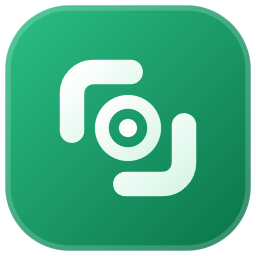

<div align="center">



# Capture Scope

**Capture what matters.**

Screen capture for Windows 11 — screenshots, scrolling capture, on-device text
extraction, screen recording, and an annotation editor.

[capturescope.app](https://capturescope.app) ·
[Changelog](https://capturescope.app/changelog) ·
[Privacy](https://capturescope.app/privacy)

</div>

---

## What this repository is

This repository exists for one purpose: **hosting the installer downloads.**

Every Capture Scope release is published here as a GitHub Release, and the
app's built-in updater downloads from exactly these release assets. It is not
the source code, and it is not where development happens — there is nothing to
build here and no code to read.

If you are looking for the product, start at
[capturescope.app](https://capturescope.app).

## Capture Scope is in private beta

Downloading the installer is not enough to use the app. **Capture Scope
requires a beta licence key**, which is sent by email when you are invited.
Without one, the app installs and opens to an activation screen.

Invites go out in small batches. You can
[request one](https://capturescope.app) from the site.

## Download

Grab the installer from the
**[latest release](https://github.com/richardtdavid/capture-scope-releases/releases/latest)**.

| | |
|---|---|
| **File** | `CaptureScope-<version>-win-x64.msi` |
| **Requires** | Windows 11, 64-bit |
| **Size** | ~90 MB |

Beta releases are marked as pre-releases, which is accurate — they are
pre-release software and will have rough edges.

## About the SmartScreen warning

**Beta installers are not yet code-signed.** Windows SmartScreen will warn that
the publisher is unknown, and you will need to click through *More info →
Run anyway* to install.

We would rather tell you this plainly than have you discover it mid-install.
Code signing is planned before general release. In the meantime, if you want to
confirm you have the genuine file, verify its hash.

<details>
<summary><strong>Verifying your download</strong></summary>

In PowerShell, hash the file you downloaded:

```powershell
Get-FileHash .\CaptureScope-0.1.0-beta.5-win-x64.msi -Algorithm SHA256
```

Then fetch the hash we publish for the current beta and compare the two:

```powershell
(Invoke-RestMethod 'https://api.capturescope.app/api/v1/update/check?channel=beta&architecture=x64').sha256
```

They should match exactly. If they do not, do not run the installer — tell us
at [hello@capturescope.app](mailto:hello@capturescope.app).

This is the same hash the app's updater checks automatically before it installs
anything, so an in-app update is already verified for you.

</details>

## Updates

Once installed, Capture Scope checks for new versions by itself, verifies the
download's SHA-256 before doing anything with it, and **asks before
installing.** Nothing is installed behind your back, and you can decline.

So for most people this repository is a one-time visit — the first install.

## What the app does

- **Screenshots** of a selected area, a window, or a full display
- **Scrolling capture** for pages taller than the screen, stitched as you scroll
- **Capture Text** — reads text out of what is on screen, entirely on your own
  machine, using the language packs Windows already has
- **Screen recording** to MP4, with system and microphone audio, and a video
  editor for trimming and resizing afterwards
- **An annotation editor** — crop, arrows, shapes, text, highlight, blur,
  pixelate, step markers, and decorative backgrounds for sharing
- **Global shortcuts** and a tray-resident launcher

## Your captures stay on your machine

Screenshots, recordings, and extracted text are created and stored locally.
They are never uploaded, and there is no setting that would send them to us.
Text extraction runs on-device.

The full detail, including the optional and default-off usage and crash
reporting, is in the [privacy policy](https://capturescope.app/privacy).

## Questions, bugs, feedback

Email **[hello@capturescope.app](mailto:hello@capturescope.app)**, or just
reply to your beta invite.

The issue tracker on this repository is not monitored — it holds release
artifacts, not the source, so there is nowhere here for a bug report to land.
Security reports are welcome at the same address with "security" in the
subject.

## Licence

Capture Scope is proprietary software. The installers published here are
distributed under the licence agreement shown during installation. This
repository contains release binaries only and grants no rights to the source.

Third-party components, including FFmpeg under the LGPL, ship with their
licences and notices inside the installed application.

<div align="center">
<sub>© 2026 Ivory Labs. All rights reserved.</sub>
</div>
